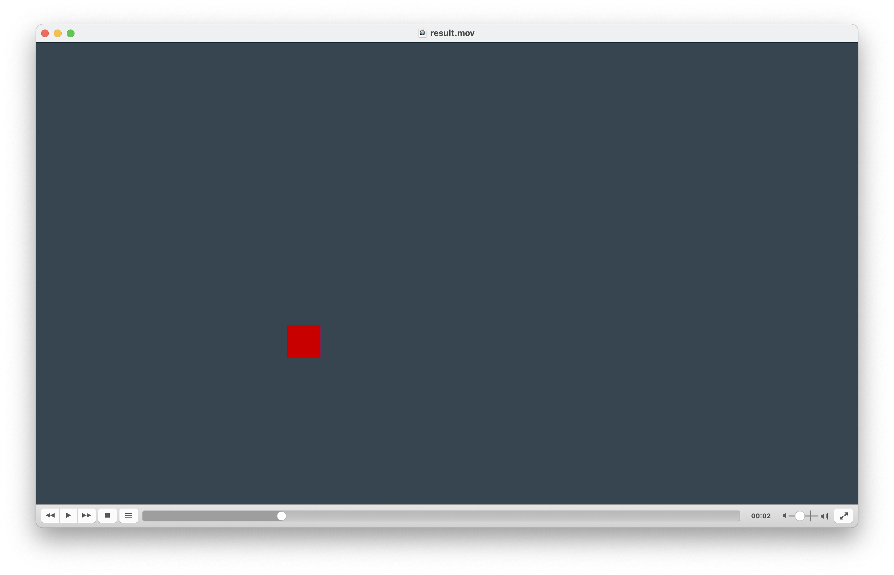

# Hack mov



Simple handmade mov container demuxer with option to write valid and short video on pure go.

*No ffmpeg!*

```bash
go run . write
```

It will generate short but heavy video. You can see its structure by following command:

```bash
go run . -ainfo -f result.mov explore
```

> [!WARNING]
> it will create video file with uncompressed data inside it! It's large! ~800mb

Output should looks like this:
```txt
Atom ftyp |0x66747970| size: 20
 mb: qt  , cmb: qt  , mv: 512
Atom wide |0x77696465| size: 8
Atom mdat |0x6d646174| size: 829440016
 s: 829440016, es: 0, ds: 829440000
Atom moov |0x6d6f6f76| size: 1929
    Atom mvhd |0x6d766864| size: 108
     duration: 10.000000s, timeScale: 1000, matrix: [0 0 9.313226e-10 0 0 0 1.5258789e-05 0 0]
    Atom trak |0x7472616b| size: 1781
        Atom tkhd |0x746b6864| size: 92
         w: 1280, h: 720, volume: 0, dur: 10000, lay: 0, alt gr: 0, id: 1
         [1 0 0 0 1 0 0 0 2.6843546e+08]
        Atom edts |0x65647473| size: 36
         noe: 1
         trak dur: 10000 media time: 0, media rate: 1
        Atom mdia |0x6d646961| size: 1645
            Atom mdhd |0x6d646864| size: 44
             creat time: 0, mod date: 0, ts: 30000, dur: 300000, lang: 32767, qual: 0
            Atom hdlr |0x68646c72| size: 44
             compType: mhlr, compSubType: vide, compName: VideoHandler
            Atom minf |0x6d696e66| size: 1549
                Atom vmhd |0x766d6864| size: 20
                 graphics mode: 0, opcolor: [0 0 0]
                Atom hdlr |0x68646c72| size: 43
                 compType: dhlr, compSubType: url , compName: DataHandler
                Atom dinf |0x64696e66| size: 36
                    Atom dref |0x64726566| size: 28
                     ver: 0, flags: [0 0 0], noe: [0 0 0 1]
                        Atom url  |0x75726c20| size: 12
                         s: 12, version: 0, flags: [0 0 1], data:
                Atom stbl |0x7374626c| size: 1442
                    Atom stsd |0x73747364| size: 146
                        Atom raw  |0x72617720| size: 130
                         s: 130, dfmt: raw , dri: 1, w: 1280, h: 720, vendor: UNKN
                         comp-r name: Lavc62.11.100 rawvideo, colorId: -1, dsize: 0, ppi: 72 72, frameC: 1
                            Atom fiel |0x6669656c| size: 10
                             count: 1, ordering: 0
                            Atom colr |0x636f6c72| size: 18
                             param type: nclc, pind: 1, tind: 1, mind: 0
                            Atom pasp |0x70617370| size: 16
                             hspacing: 1, vspacing: 1
                    Atom stts |0x73747473| size: 24
                     noe: 1
                     count: 300, dur: 1000
                    Atom stsc |0x73747363| size: 28
                     noe: 1
                     first: 1, S/Chunk: 1, SdescID: 1
                    Atom stsz |0x7374737a| size: 20
                     sample size: 2764800, noe: 300
                     sizes are equal (table is empty)
                    Atom stco |0x7374636f| size: 1216
                     noe: 300
                     offset: 36
                     offset: 2764836
                     offset: 5529636
                     offset: 8294436
                     offset: 11059236
                     ... and + 295 lines
    Atom udta |0x75647461| size: 32
        Atom �swr |0xa9737772| size: 24
         software generated info: __U_Lavf62.3.100
```


